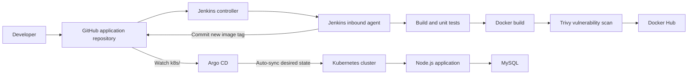

# Full CI/CD with GitOps

An end-to-end delivery project for a Node.js application backed by MySQL. Docker Compose supports local development; Jenkins tests the app, builds and scans its image, and publishes the desired image tag to Git; Argo CD synchronizes that Git state to Kubernetes.

**Core design:** Jenkins does not deploy to the cluster with `kubectl`. Jenkins updates Git, and Argo CD performs the deployment reconciliation.

## Architecture


The Jenkins agent sends the versioned image to Docker Hub and separately commits the image reference to GitHub. Argo CD watches `k8s/` and reconciles the application resources in Kubernetes. MySQL and shared cluster prerequisites are provisioned separately from this GitOps application.

<details>
<summary>View the editable Mermaid architecture source</summary>



</details>

The repository's `k8s/` directory contains the application Deployment, ClusterIP Service, and database NetworkPolicy. The namespace, MySQL StatefulSet and headless Service, ConfigMap, Secret, and persistent volumes are prerequisites managed separately in the cluster.

## Delivery workflow

1. Develop and run the app with MySQL locally through Docker Compose.
2. Jenkins checks out the repository and runs the pipeline on the `lab22-agent` inbound agent.
3. The `Build App` Shared Library step installs dependencies, runs unit tests, and checks the Node.js syntax.
4. `Build, Scan, Push Image` builds `maielshazly/ivolve-app:<BUILD_NUMBER>`, scans it with Trivy, pushes it to Docker Hub, then removes the local image tag.
5. `Update Deployment` replaces the image tag in `k8s/deployment.yaml`, commits the manifest, and pushes the commit to `main`.
6. Argo CD notices the new commit and automatically reconciles the `ivolve` application.
7. Kubernetes rolls out Pods using the image version recorded in Git.

Trivy is configured with `--exit-code 0`, so findings are reported but do not currently fail the build. A future hardening step is to make high and critical findings block image publication.

## Repository layout

```text
.
├── agent/Dockerfile          # Jenkins inbound agent tools
├── argocd/application.yaml   # Argo CD Application manifest
├── docs/                     # Setup, operations, and troubleshooting guides
│   └── images/               # Project evidence screenshots
├── frontend/                 # Static app UI and assets
├── k8s/                      # GitOps-managed app resources
├── vars/                     # Jenkins Shared Library steps
├── Dockerfile                # Node.js application image
├── docker-compose.yml        # Local app + MySQL stack
├── Jenkinsfile               # CI and GitOps stages
├── db.js / db-check.js       # MySQL access and unit-test helper
├── server.js                 # Express app and health endpoints
└── package.json              # Node dependencies and scripts
```

## Run locally with Docker Compose

### Requirements

- Docker Desktop or Docker Engine with Docker Compose
- Node.js is optional for local development; the app runs in its container

Create a local environment file from the template, then set strong local-only passwords:

```powershell
Copy-Item .env.example .env
notepad .env
docker compose config
docker compose up -d --build
docker compose ps
docker compose logs -f app
```

Open [http://localhost:3000](http://localhost:3000). The app's `/health` and `/ready` endpoints check application/database availability.

Stop the containers while retaining named-volume data:

```powershell
docker compose down
```

To also delete the local MySQL and log volumes:

```powershell
docker compose down -v
```

The `.env` file is ignored by Git. Never put real passwords in the README, manifests, screenshots, or commits.

## Kubernetes platform and application

The project cluster uses kubeadm on Ubuntu, containerd as the runtime, and Calico for Pod networking. The worker is labeled `project=ivolve` and tainted `workload=ivolveApp:NoSchedule`; the application Deployment selects that node and tolerates that taint.

Before Argo CD syncs the app resources, the cluster must already have:

- Namespace `ivolve` and sufficient ResourceQuota capacity
- ConfigMap `ivolvcm` with `DB_HOST` and `DB_USER`
- Secret `ivolvesecret` with `DB_PASSWORD` and `MYSQL_ROOT_PASSWORD`
- MySQL StatefulSet `ivolvedb` and headless Service `ivolvedbsvc`
- PersistentVolumeClaim `ivolvepvc` for application logs

The Deployment's init container waits for MySQL and creates the `ivolve` database/application user. The application receives connection settings from the ConfigMap and Secret. The NetworkPolicy permits MySQL ingress on TCP 3306 from the application Pods.

Inspect the GitOps-managed resources after synchronization:

```bash
kubectl get deployment,pods,service,networkpolicy -n ivolve -o wide
kubectl get deployment ivolveapp -n ivolve \
  -o jsonpath='{.spec.template.spec.containers[?(@.name=="ivolve-app")].image}{"\n"}'
```

The image tag in the output should match the latest successful Jenkins build and the image tag committed in `k8s/deployment.yaml`.

## Jenkins setup

### Controller, inbound agent, and tools

Run the Jenkins controller and confirm that it is available before configuring the job. Build the separate inbound agent image from the repository root:

```powershell
docker build -t ivolve-jenkins-agent:gitops -f agent/Dockerfile agent
```

Create an inbound Jenkins node named `lab22-agent`, set its remote work directory and executor count, and connect the agent using the Jenkins-generated secret. Keep the secret out of source control and screenshots. The node should show **Online** before a build is scheduled.

The agent image includes Node.js/npm, Docker tooling, and Trivy. It deliberately does **not** install `kubectl`: the GitOps pipeline does not call `kubectl`, and the agent needs no Kubernetes kubeconfig. Docker commands use the Docker engine/socket configured for the agent in this isolated lab environment.

### Shared Library

In **Manage Jenkins → System → Global Pipeline Libraries**, configure:

- **Name:** `ivolve-gitops` (must match `@Library('ivolve-gitops')` in `Jenkinsfile`)
- **Default version:** `main`
- **Retrieval method:** Modern SCM / Git
- **Project repository:** this GitHub repository

The `vars/` directory contains the global steps `BuildApp`, `BuildImage`, and `UpdateDeployment`. Keeping the GitOps step named `UpdateDeployment` makes its responsibility distinct from a direct Kubernetes deployment helper.

### Jenkins credentials

Create these credentials in Jenkins' Credentials store. The README records credential IDs only; never capture or publish credential values.

- **`dockerhub-creds`** — Username with a Docker Hub access token as the password; used only to log in and push the image.
- **`github-write-creds`** — GitHub username with a fine-grained token as the password; grant repository Contents read/write on this project repository so Jenkins can push the manifest commit.

The repository is public, so Argo CD can read it without repository credentials. If you make it private, configure a read-only repository credential in Argo CD separately. Do not use a Jenkins kubeconfig credential for this GitOps flow.

### Pipeline job and verification

Create a Pipeline-from-SCM job or Multibranch Pipeline using this repository, branch `main`, and script path `Jenkinsfile`. The Jenkinsfile selects agent label `lab22-agent` and runs:

```text
Build App → Build, Scan, Push Image → Update Deployment
```

After **Build Now**, verify all stages succeed. In the final stage, confirm Jenkins commits and pushes the updated image tag. An image push alone is not a complete GitOps delivery: the manifest commit must also reach GitHub.

## Argo CD setup and verification

Install Argo CD into namespace `argocd`, wait for its server, repo server, Redis, application controller, and supporting Pods to become Ready, then connect the project repository. The declarative reference is [`argocd/application.yaml`](argocd/application.yaml).

The `ivolve` Application settings are:

- **Repository:** `https://github.com/Maielshazlyy/Full-CI-CD-with-GitOps-project.git`
- **Revision:** `main`
- **Manifest path:** `k8s`
- **Destination:** in-cluster Kubernetes API, namespace `ivolve`
- **Sync policy:** automated sync and self-heal enabled; pruning disabled

Do not create a second `ivolve` Application if one already exists. Update the existing application's source when switching repositories. Argo CD manages only the resources under `k8s/`; cluster prerequisites listed above remain separately managed.

Verify the application and its live image:

```bash
kubectl get applications.argoproj.io ivolve -n argocd
kubectl get pods -n argocd -o wide
kubectl get deployment,pods,service -n ivolve -o wide
kubectl get deployment ivolveapp -n ivolve \
  -o jsonpath='{.spec.template.spec.containers[?(@.name=="ivolve-app")].image}{"\n"}'
```

In Argo CD, confirm the application is **Healthy** and **Synced**, and that the source revision, `k8s` path, and `ivolve` destination match the settings above. For secure UI access through SSH tunneling, see [`docs/05-argocd-gitops.md`](docs/05-argocd-gitops.md).

## Evidence screenshots

Store screenshots in `docs/images/` and embed them in this README at the corresponding evidence point. The names below keep the gallery ordered and explain what each capture should prove.

| File name | Capture | What it demonstrates |
|---|---|---|
| `01-jenkins-controller-agent-online.png` | Docker Desktop/container list showing Jenkins running, plus the Jenkins node page | Controller is running and inbound agent is Online |
| `02-jenkins-library-job-config.png` | Global Pipeline Library and pipeline job configuration | Library name `ivolve-gitops`, `main` branch, and `Jenkinsfile` script path |
| `03-jenkins-credentials-ids.png` | Jenkins Credentials listing | `dockerhub-creds` and `github-write-creds` exist; values must remain hidden |
| `04-jenkins-pipeline-success.png` | Completed Jenkins Stage View | All three stages pass, including **Update Deployment** |
| `05-dockerhub-image-published.png` | Docker Hub repository tags page | Image tag matches the successful Jenkins build number |
| `06-argocd-namespace-running.png` | Terminal output of `kubectl get pods -n argocd -o wide` | Argo CD components are running |
| `07-argocd-repository-connected.png` | Argo CD repository settings/status | The GitHub repository connection succeeds |
| `08-argocd-application-healthy.png` | Argo CD `ivolve` application details | Application is **Healthy** and **Synced**, with correct repo, revision, path, and namespace |
| `09-kubernetes-app-pods-running.png` | Terminal output of `kubectl get deployment,pods,service -n ivolve -o wide` | Application Deployment, Pods, and Service are running with the expected image |

The architecture image is stored at `docs/images/full-cicd-gitops-architecture.png` and is already embedded above.

Only the Argo CD and Kubernetes evidence already published with the standalone Lab 23 README is currently referenced below. Add the Jenkins, credential-list, and Docker Hub captures to `docs/images/` as listed above, then embed them with this pattern:

```markdown

```

### Existing Argo CD and Kubernetes evidence

These captures are reused from the Lab 23 submission. Replace them with project-specific captures if the repository, branch, or image tag changes.

<p align="center"><strong>Argo CD application and synchronization</strong></p>


<p align="center"><strong>Argo CD resource and GitOps evidence</strong></p>


<p align="center"><strong>Kubernetes deployment verification</strong></p>


Do not include Jenkins agent secrets, tokens, passwords, kubeconfig contents, database Secret values, or private keys in screenshots.

## Documentation

- [Docker Compose and application/database flow](docs/01-docker-compose.md)
- [kubeadm cluster setup](docs/02-kubeadm-cluster.md)
- [Kubernetes resources and apply order](docs/03-kubernetes-yaml.md)
- [Jenkins Shared Library, credentials, and inbound agent](docs/04-jenkins-ci.md)
- [Argo CD GitOps delivery](docs/05-argocd-gitops.md)

## Official references

- [Docker Compose](https://docs.docker.com/compose/)
- [Kubernetes kubeadm](https://kubernetes.io/docs/setup/production-environment/tools/kubeadm/)
- [Jenkins agents](https://www.jenkins.io/doc/book/using/using-agents/)
- [Jenkins Shared Libraries](https://www.jenkins.io/doc/book/pipeline/shared-libraries/)
- [Argo CD Getting Started](https://argo-cd.readthedocs.io/en/stable/getting_started/)
