# Full CI/CD GitOps Project

An end-to-end delivery workflow for a Node.js application backed by MySQL. Docker Compose runs the application and database locally. Jenkins builds, tests, scans, and publishes a versioned application image, then commits that image tag to GitHub. Argo CD watches the Kubernetes manifests in Git and reconciles the cluster automatically.

> **GitOps boundary:** Jenkins does not run `kubectl` and does not need a Kubernetes kubeconfig. Jenkins publishes the desired state to Git; Argo CD applies it to Kubernetes.

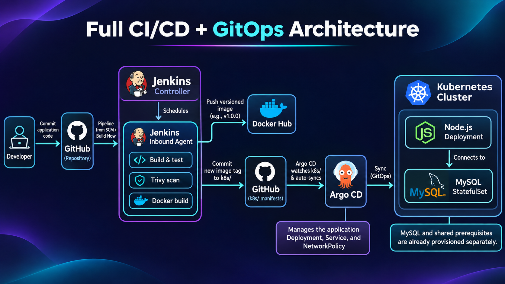

## Project Walkthrough

[▶ Watch the 80-second portfolio video](animation/out/full-cicd-portfolio.mp4)

## Contents

- [What the project builds](#what-the-project-builds)
- [Repository map](#repository-map)
- [1. Run the app and database locally](#1-run-the-app-and-database-locally)
- [2. Prepare the Kubernetes cluster](#2-prepare-the-kubernetes-cluster)
- [3. Prepare the application namespace and MySQL](#3-prepare-the-application-namespace-and-mysql)
- [4. Configure Jenkins and its agent](#4-configure-jenkins-and-its-agent)
- [5. Configure the Shared Library and credentials](#5-configure-the-shared-library-and-credentials)
- [6. Create and run the Jenkins pipeline](#6-create-and-run-the-jenkins-pipeline)
- [7. Install and configure Argo CD](#7-install-and-configure-argo-cd)
- [8. Follow a change from Git to the running app](#8-follow-a-change-from-git-to-the-running-app)
- [9. Verify the finished deployment](#9-verify-the-finished-deployment)
- [Troubleshooting](#troubleshooting)
- [Security notes](#security-notes)

## What the project builds

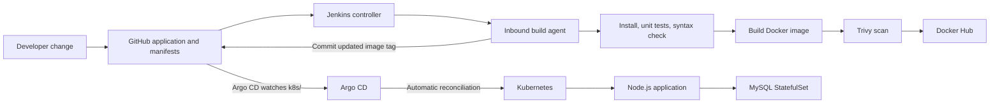

The application serves a web UI on port `3000`, connects to MySQL, exposes `/health` and `/ready`, and writes access logs under `/app/logs`. MySQL is a separate service with persistent storage. In the cluster, the database and shared prerequisites are established before Argo CD deploys the application.

## Repository map

```text
.
├── agent/Dockerfile          # Jenkins inbound agent image and build tools
├── argocd/application.yaml   # Argo CD Application definition
├── docs/                     # Detailed setup guides
│   └── images/               # Inline screenshots and architecture figure
├── frontend/                 # Static web application files
├── k8s/                      # App Deployment, Service, and NetworkPolicy
├── vars/                     # Jenkins Shared Library steps
├── Dockerfile                # Node.js app image
├── docker-compose.yml        # Local app + MySQL services
├── Jenkinsfile               # CI/GitOps pipeline stages
├── db.js / db-check.js       # Database access and test helper
├── server.js                 # Express app and health endpoints
└── package.json              # Node dependencies and scripts
```

More detailed platform notes are in [Docker Compose](docs/01-docker-compose.md), [kubeadm](docs/02-kubeadm-cluster.md), [Kubernetes manifests](docs/03-kubernetes-yaml.md), [Jenkins](docs/04-jenkins-ci.md), and [Argo CD](docs/05-argocd-gitops.md).

## 1. Run the app and database locally

### Requirements

- Git
- Docker Desktop or Docker Engine with the Compose plugin
- Node.js only if you want to run the unit tests outside Jenkins

From the repository root, create a local environment file and replace its placeholder passwords. Do not commit `.env`.

```powershell
Copy-Item .env.example .env
notepad .env
docker compose config
docker compose up -d --build
docker compose ps
```

Compose starts two services:

1. `db` starts MySQL and becomes healthy when `mysqladmin ping` succeeds.
2. `app` starts after the database health check. It connects to host `db`, the Compose service DNS name, on the internal network `ivolve-net`.
3. `db_data` persists MySQL data and `app_logs` persists application logs across container replacement.

Open [http://localhost:3000](http://localhost:3000), then check the health endpoint at [http://localhost:3000/health](http://localhost:3000/health). To inspect application output:

```powershell
docker compose logs -f app
```

The Compose stack built and started successfully, the app connected to MySQL, and the app UI and Docker Hub image were verified:

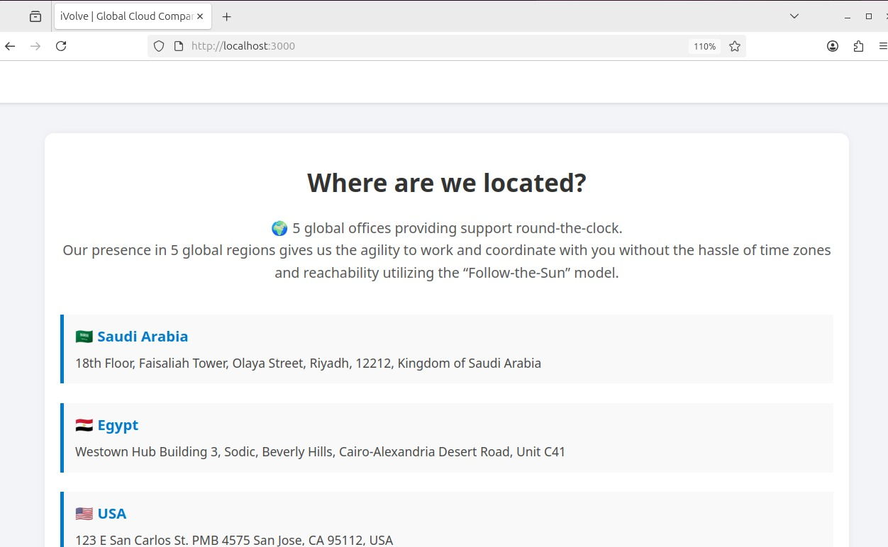

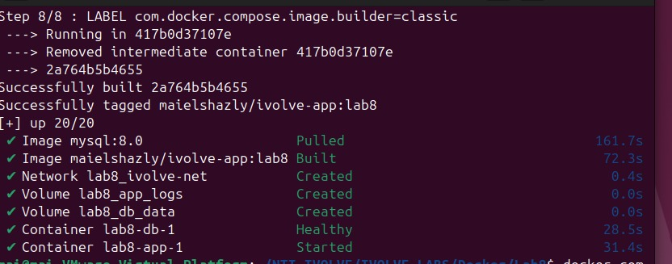

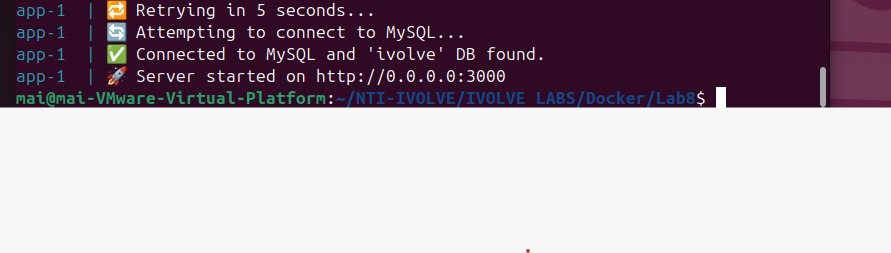

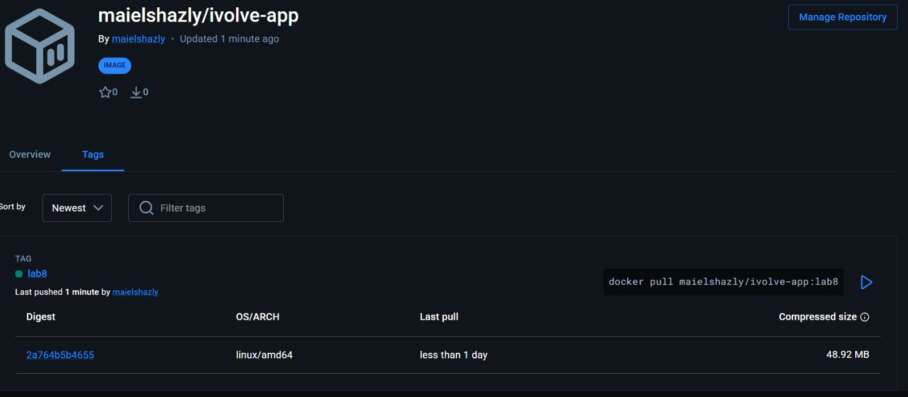

Stop the services but keep their data:

```powershell
docker compose down
```

Remove the named volumes only when you intend to delete the local database and logs:

```powershell
docker compose down -v
```

## 2. Prepare the Kubernetes cluster

The lab cluster consists of Ubuntu EC2 control-plane and worker nodes, kubeadm, containerd, and Calico. The project depends on that cluster; it does not provision EC2 or bootstrap Kubernetes automatically.

Follow [the cluster setup guide](docs/02-kubeadm-cluster.md) for the full node preparation and kubeadm sequence. In brief, the setup is:

1. Put both EC2 instances in the same VPC and allow only the required traffic between them. Limit SSH and Kubernetes API access to trusted sources.
2. Disable swap and configure kernel modules, forwarding, and bridge networking on both nodes.
3. Install and configure containerd with the systemd cgroup driver.
4. Install matching `kubelet`, `kubeadm`, and `kubectl` versions on both nodes.
5. Run `kubeadm init` on the control-plane, configure the admin user's kubeconfig, install Calico, and join the worker with the generated join command.
6. Wait until both nodes report `Ready`, then apply the project scheduling label and taint to the worker.

Example verification and worker scheduling setup (replace the node names if yours differ):

```bash
kubectl get nodes -o wide
kubectl get pods -A
kubectl label node <worker-node-name> project=ivolve --overwrite
kubectl taint node <worker-node-name> workload=ivolveApp:NoSchedule --overwrite
kubectl get nodes --show-labels
kubectl describe node <worker-node-name> | grep -i taints
```

Both cluster nodes reached `Ready`, and the Kubernetes system and Calico components were running:

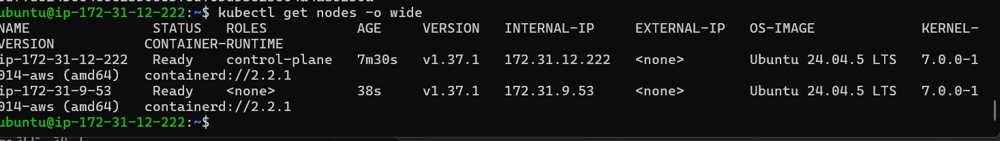

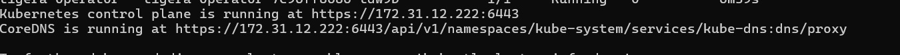

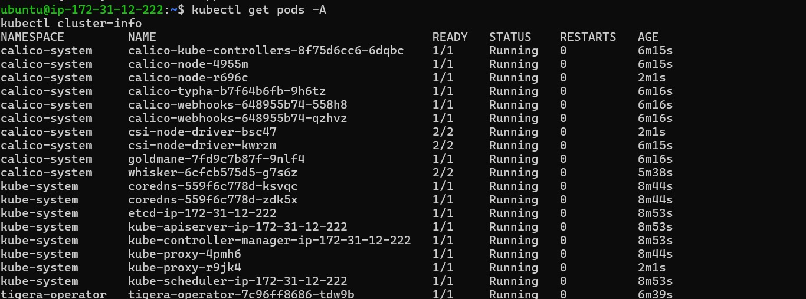

The app's `nodeSelector` chooses `project=ivolve`; its toleration permits the `workload=ivolveApp:NoSchedule` taint. These settings control placement but do not add CPU or memory. This lab's small EC2 nodes can become resource constrained, so verify capacity before installing optional monitoring or increasing workloads.

## 3. Prepare the application namespace and MySQL

The Argo CD application in this repository owns only the manifests in `k8s/`. Prepare the database and shared resources separately before creating or syncing the Argo CD application.

Required resources in namespace `ivolve`:

- Namespace `ivolve` and enough ResourceQuota capacity for the database plus two app replicas.
- ConfigMap `ivolvcm` with `DB_HOST=ivolvedbsvc` and `DB_USER=ivolve_user`.
- Secret `ivolvesecret` containing `MYSQL_ROOT_PASSWORD` and `DB_PASSWORD`.
- MySQL StatefulSet `ivolvedb` and headless Service `ivolvedbsvc`.
- Bound PVC `ivolvepvc` for the application's `/app/logs` mount.

Use the existing database and storage manifests from the Kubernetes work to create these prerequisites. Never copy real Secret values into this repository. Check that database DNS and the claim work before app deployment:

```bash
kubectl get namespace ivolve
kubectl get configmap ivolvcm -n ivolve
kubectl get secret ivolvesecret -n ivolve
kubectl get statefulset,service,pvc -n ivolve
kubectl get pods -n ivolve -o wide
```

The database StatefulSet and both persistent claims were running and bound. The MySQL client also confirmed that the `ivolve` database exists:

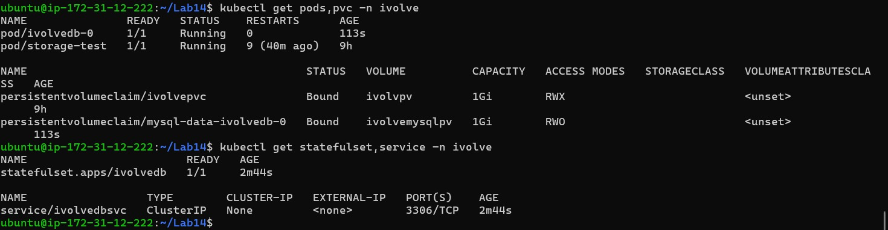

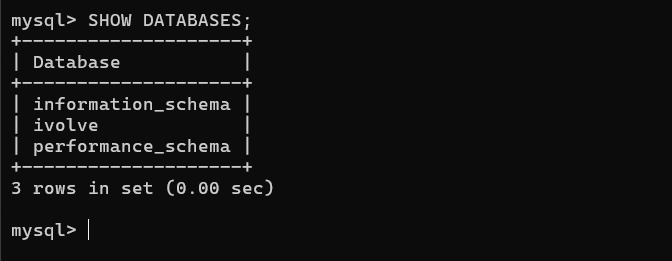

The application log claim was also bound and verified with a test Pod:

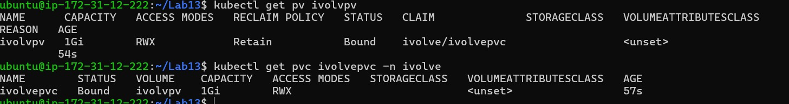

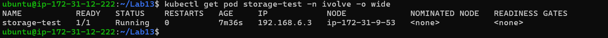

The Deployment's `initialize-database` init container waits for MySQL and ensures the `ivolve` database and application user exist. The application then reads database connection values from the ConfigMap and Secret. The NetworkPolicy allows MySQL ingress on TCP `3306` from Pods labeled `app=ivolveapp`.

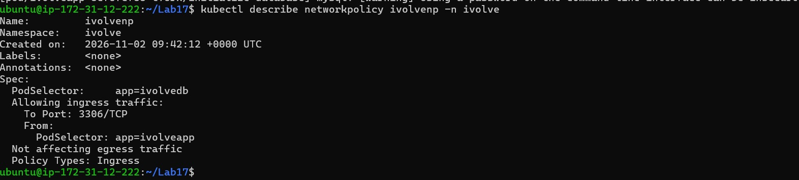

> ResourceQuota in the lab limits namespace Pods. Keep the database and app replicas within the quota. The Deployment uses `maxSurge: 0` and `maxUnavailable: 1` so a rolling update can replace app Pods without temporarily exceeding the Pod quota.

## 4. Configure Jenkins and its agent

### Start the Jenkins controller

Run Jenkins using the controller setup you already use for the lab. Confirm the UI is reachable, sign in with the administrator account, and ensure the controller container is healthy before configuring the agent. Keep the Jenkins home volume persistent so jobs, credentials, plugins, and configuration survive a restart.

### Build the inbound agent image

From the repository root:

```powershell
docker build -t ivolve-jenkins-agent:gitops -f agent/Dockerfile agent
```

The agent image includes Java from the inbound-agent base, Node.js/npm, Docker CLI, and Trivy. The agent connects to Jenkins over WebSocket. Docker access uses the local Docker socket in this lab setup.

### Create and connect the agent

In Jenkins:

1. Open **Manage Jenkins → Nodes → New Node**.
2. Name it `lab22-agent`, select **Permanent Agent**, and create it.
3. Set the remote root directory to `/home/jenkins/agent`, set at least one executor, and assign the label `lab22-agent`.
4. Save, open the node page, and use its generated inbound-agent command/secret to start the agent container with the image above.
5. Confirm the node page says **Agent is connected** or **Online** before starting a build.

Do not put the agent secret in Git, README, screenshots, or shell history. The `Jenkinsfile` schedules its build on `lab22-agent`.

The Jenkins node list confirms that the dedicated inbound agent is online:

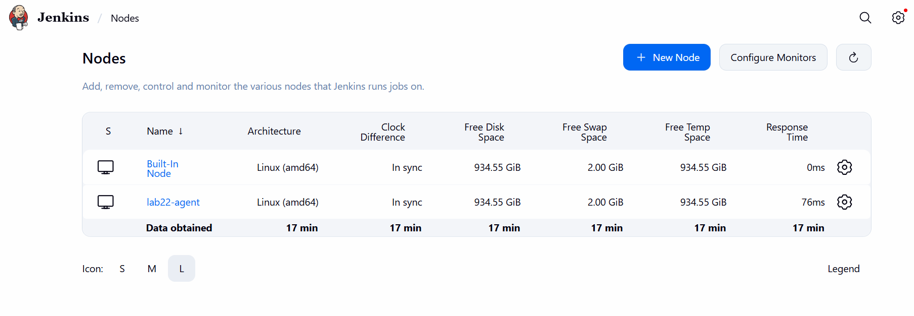

### Why this agent has no kubectl

The Jenkins agent runs CI tasks and pushes an image and manifest commit. It does not apply Kubernetes YAML. Argo CD runs in the cluster and performs that reconciliation, so a Jenkins kubeconfig and `kubectl` are not needed for this workflow.

## 5. Configure the Shared Library and credentials

### Register the Global Pipeline Library

In Jenkins, open **Manage Jenkins → System → Global Pipeline Libraries** and add:

- **Name:** `ivolve-gitops` — this must match the `@Library('ivolve-gitops')` annotation in `Jenkinsfile`.
- **Default version:** `main`.
- **Retrieval method:** Modern SCM → Git.
- **Project repository:** this project's GitHub clone URL.
- **Credentials:** add read credentials if the source repository is private.

Save the configuration. Jenkins loads the reusable global steps from the library repository's root `vars/` directory. This project has `BuildApp.groovy`, `BuildImage.groovy`, and `UpdateDeployment.groovy`.

### Add credentials in Jenkins

Open **Manage Jenkins → Credentials → System → Global credentials → Add Credentials**. Use these IDs exactly because the pipeline refers to them:

| ID | Type | Value and scope |
|---|---|---|
| `dockerhub-creds` | Username with password | Docker Hub username; use a Docker Hub access token as the password. Allow image push to `maielshazly/ivolve-app`. |
| `github-write-creds` | Username with password | GitHub username; use a fine-grained token as the password. Grant Contents read/write to this project repository so Jenkins can update `k8s/deployment.yaml`. |

Store the credentials in Jenkins only. Never paste the tokens in the Jenkinsfile, image, README, screenshot, or Git history. Argo CD can read this public repository without credentials; for a private repository, configure a separate read-only Git credential in Argo CD.

## 6. Create and run the Jenkins pipeline

Create a **Pipeline** job in Jenkins:

1. Select **Pipeline script from SCM**.
2. Choose **Git**, enter this repository's URL, and set branch to `*/main`.
3. Set **Script Path** to `Jenkinsfile`.
4. Save and click **Build Now**.

Add the Jenkins Stage View screenshot after a successful run as `docs/images/07-jenkins-pipeline-success.png`. It should show **Build App**, **Build, Scan, Push Image**, and **Update Deployment** green, with the build number visible if possible.

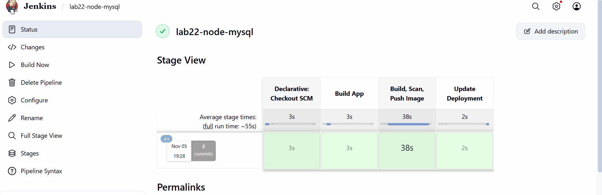

The pipeline runs on `lab22-agent` in these stages:

1. **Build App** — `BuildApp()` installs npm dependencies, runs `npm test`, and checks JavaScript syntax with `node --check server.js`.
2. **Build, Scan, Push Image** — `BuildImage()` builds `maielshazly/ivolve-app:<BUILD_NUMBER>`, scans it with Trivy, authenticates using `dockerhub-creds`, pushes it to Docker Hub, logs out, and removes the local tag.
3. **Update Deployment** — `UpdateDeployment()` changes the image field in `k8s/deployment.yaml` to the build tag, commits the manifest change, and pushes it to `main` using `github-write-creds`.

Trivy currently uses `--exit-code 0`: it reports High/Critical vulnerabilities but does not fail the build on findings. A successful Docker push is not the end of this pipeline; confirm that the **Update Deployment** stage also pushed a Git commit.

After the image push, capture the Docker Hub **Tags** page with the same build number as `docs/images/08-dockerhub-build-tag.png`. After the manifest push, capture the GitHub commit or updated `k8s/deployment.yaml` as `docs/images/09-github-manifest-commit.png`.

The unit tests can also be run locally from the project root:

```powershell
npm install
npm test
```

## 7. Install and configure Argo CD

### Install Argo CD

Install Argo CD on a responsive cluster. If the API server is timing out, first check `free -h`, `uptime`, disk I/O, and node readiness instead of repeatedly applying the installation manifest.

```bash
kubectl create namespace argocd
kubectl apply --server-side --force-conflicts -n argocd \
  -f https://raw.githubusercontent.com/argoproj/argo-cd/stable/manifests/install.yaml
kubectl get pods -n argocd -o wide
```

Wait for the Argo CD server, repo server, Redis, and application controller Pods to become Ready. If cluster taints prevent scheduling, configure explicit tolerations on the Argo CD components that must run there; do not remove node taints globally just to bypass scheduling.

### Open the Argo CD UI securely

Use an SSH tunnel rather than exposing Argo CD publicly. Start a port-forward on the control-plane using an authorized kubeconfig, then create an SSH local forward from the workstation. Detailed commands and troubleshooting for the lab's API-server endpoint are in [the Argo CD guide](docs/05-argocd-gitops.md). Keep both tunnel processes running while using the UI.

### Create or update the `ivolve` Application

The declarative definition is [`argocd/application.yaml`](argocd/application.yaml). Its key settings are:

- **Name:** `ivolve`
- **Repository:** `https://github.com/Maielshazlyy/Full-CI-CD-with-GitOps-project.git`
- **Revision:** `main`
- **Path:** `k8s`
- **Destination:** in-cluster Kubernetes, namespace `ivolve`
- **Sync policy:** automated sync with self-heal; pruning is disabled

Create the Application once, or update the existing `ivolve` Application to use this repository. Do not create multiple Applications with the same name. The `k8s/` directory must contain valid manifests and the namespace prerequisites must already exist.

Verify the live Application source and status:

```bash
kubectl get application ivolve -n argocd \
  -o jsonpath='{.spec.source.repoURL}{" | "}{.spec.source.path}{"\n"}{.status.sync.status}{" | "}{.status.health.status}{"\n"}'
```

Expected source is this project repository with path `k8s`; after reconciliation, expected status is `Synced | Healthy`.

The Argo CD capture below shows automatic synchronization and a successful sync. Use the verification command above to confirm this project's repository and `k8s` path; add a fresh Application details capture as `docs/images/10-argocd-healthy-synced.png` showing the repository, revision `main`, path `k8s`, namespace `ivolve`, and **Healthy / Synced** status.

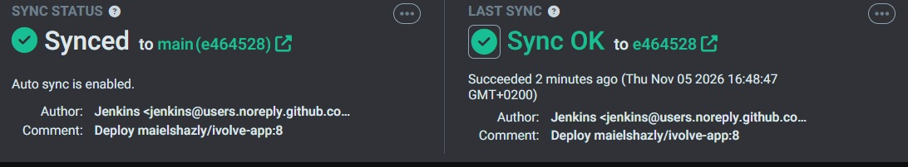

## 8. Follow a change from Git to the running app

This is the end-to-end release loop:

1. Make an application change and push it to the source repository's `main` branch.
2. Start the Jenkins pipeline (or later connect a GitHub webhook to trigger it automatically).
3. Jenkins checks out the source on the inbound agent, runs the unit tests and syntax check, builds the container image, scans it, and pushes a build-number tag to Docker Hub.
4. Jenkins changes the image reference in `k8s/deployment.yaml` and pushes a Git commit to `main`.
5. Argo CD detects the new Git revision and automatically syncs the `k8s/` manifests.
6. Kubernetes rolls out Pods for the new image. The app's init container waits for MySQL and provisions the expected database/user before the app starts.
7. Confirm the Argo CD Application is **Synced** and **Healthy**, the Deployment is ready, and the live image tag matches both Docker Hub and Git.

If Jenkins completes the image push but fails during the Git push, Argo CD has no new desired state to apply. Fix the GitHub credential/repository permissions, then rerun the pipeline.

## 9. Verify the finished deployment

Run on the cluster with an authorized `kubectl` identity:

```bash
kubectl get nodes -o wide
kubectl get pods -n argocd -o wide
kubectl get application ivolve -n argocd
kubectl get deployment,pods,service,networkpolicy -n ivolve -o wide
kubectl rollout status deployment/ivolveapp -n ivolve --timeout=180s
kubectl get deployment ivolveapp -n ivolve \
  -o jsonpath='{.spec.template.spec.containers[?(@.name=="ivolve-app")].image}{"\n"}'
```

The cluster verification captures below show the nodes and workloads running. Add a fresh final-run capture as `docs/images/11-kubernetes-final-rollout.png` showing the Deployment at `2/2`, app and MySQL Pods running, and the image tag matching Docker Hub and Git.

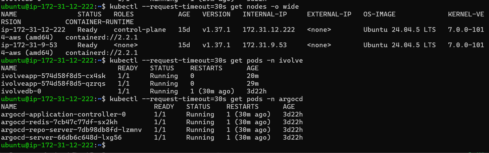

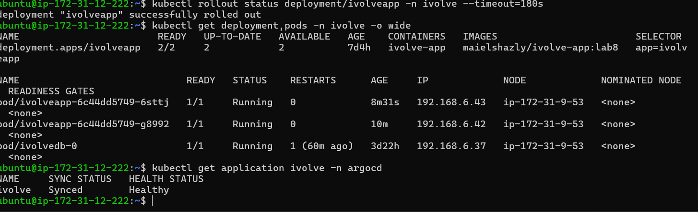

Check application logs and the database endpoint if readiness does not complete:

```bash
kubectl logs -n ivolve -l app=ivolveapp -c ivolve-app --tail=50
kubectl get endpointslice -n ivolve -l kubernetes.io/service-name=ivolvedbsvc
kubectl get events -n ivolve --sort-by=.lastTimestamp | tail -20
```

The app image reported by the Deployment should equal the latest image tag in `k8s/deployment.yaml` and the corresponding tag published to Docker Hub. In Argo CD, confirm the same repository, revision, path, destination, **Synced** status, and **Healthy** status.

## Troubleshooting

| Symptom | What to check |
|---|---|
| Jenkins build stays queued | Check that `lab22-agent` is Online, has an executor, and the job uses the `lab22-agent` label. |
| Jenkins cannot load `@Library` | Confirm the Global Pipeline Library name is exactly `ivolve-gitops`, its Git URL/branch are correct, and Jenkins can read the repository. |
| Docker push is denied | Check `dockerhub-creds`, access token validity, and write access to `maielshazly/ivolve-app`. |
| Git push returns 403 | Check `github-write-creds` and the token's Contents read/write permission for this repository. Verify the failure is not a read-only or wrong-repository token. |
| Argo CD remains OutOfSync | Confirm it tracks this repository, `main`, and `k8s`; then check that Jenkins pushed its image-tag commit. |
| Argo CD is Synced but not Healthy | Inspect Pod events, quota, taints, PVC binding, ConfigMap/Secret presence, MySQL connectivity, and image pull status. |
| App Deployment shows fewer than 2 replicas | Check ResourceQuota and node capacity; this lab's quota is small. Inspect `kubectl describe deployment ivolveapp -n ivolve`. |
| Argo UI or `kubectl` is slow | Check API server readiness and node memory/CPU/I/O. The lab nodes are small; stop optional workloads if needed. |

## Security notes

- `.env` is ignored by Git; `.env.example` contains placeholders only. Use separate strong local passwords.
- Kubernetes Secret values must be created securely on the cluster and must not be committed as plain YAML.
- Jenkins credentials are referenced by ID and injected only into the relevant pipeline step.
- Restrict GitHub token permissions to repository Contents read/write and Docker Hub token permissions to the required image operations.
- Do not expose Jenkins, Argo CD, Kubernetes API, or Docker socket publicly. The mounted Docker socket provides powerful access to the host and is for this isolated lab environment only.
- This learning setup is not a production high-availability design. Use hardened secrets management, resource sizing, backups, TLS, access controls, and policy enforcement before production use.

## Further reading

- [Docker Compose guide](docs/01-docker-compose.md)
- [kubeadm cluster guide](docs/02-kubeadm-cluster.md)
- [Kubernetes manifests guide](docs/03-kubernetes-yaml.md)
- [Jenkins CI, agent, and Shared Library guide](docs/04-jenkins-ci.md)
- [Argo CD GitOps guide](docs/05-argocd-gitops.md)
- [Docker Compose documentation](https://docs.docker.com/compose/)
- [kubeadm documentation](https://kubernetes.io/docs/setup/production-environment/tools/kubeadm/)
- [Jenkins Shared Libraries](https://www.jenkins.io/doc/book/pipeline/shared-libraries/)
- [Argo CD documentation](https://argo-cd.readthedocs.io/en/stable/)
