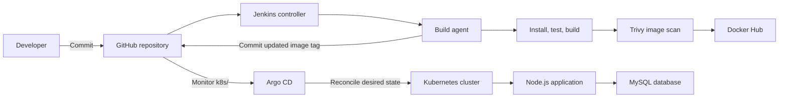

# Full CI/CD with GitOps

An end-to-end reference project for building, packaging, testing, scanning, and deploying a Node.js application backed by MySQL. It combines Docker Compose for local development, Kubernetes for orchestration, Jenkins for continuous integration, and Argo CD for GitOps-based delivery.

## Overview

The application and database run as separate services. Jenkins builds and tests the application, creates and scans a container image, and publishes the image to Docker Hub. It then updates the Kubernetes manifest in Git. Argo CD watches the repository and reconciles the cluster to the committed configuration.

## Architecture



Jenkins owns the build and image-publishing workflow. Argo CD owns the deployment reconciliation. The Git manifest is the source of truth for the application Deployment, Service, and NetworkPolicy.

## Technology stack

- **Application:** Node.js, Express, MySQL client, static frontend
- **Local development:** Docker, Docker Compose, named volumes, bridge networking
- **Container registry:** Docker Hub
- **Orchestration:** Kubernetes with kubeadm, containerd, and Calico
- **Continuous integration:** Jenkins Pipeline, inbound agent, Shared Library
- **Image security:** Trivy
- **Continuous delivery:** Argo CD automated synchronization

## Repository structure

```text
.
├── agent/                  # Jenkins inbound agent image definition
├── argocd/                 # Argo CD Application manifest
├── docs/                   # Setup, operation, and troubleshooting guides
├── frontend/               # Static web interface and assets
├── k8s/                    # GitOps-managed application resources
├── kubernetes-labs/        # Reference manifests from earlier exercises
├── vars/                   # Jenkins Shared Library functions
├── Dockerfile              # Application image build
├── docker-compose.yml      # Local application and database services
├── Jenkinsfile             # CI and GitOps pipeline
├── db.js                   # Database access
├── server.js               # HTTP application and health endpoints
└── package.json            # Dependencies and test commands
```

The Argo CD application watches `k8s/`, which contains only the final application Deployment, Service, and NetworkPolicy. Supporting cluster resources—namespace, database, credentials, and persistent volumes—must already exist in the cluster and are configured separately.

## Local development

### Prerequisites

- Docker Desktop or Docker Engine with Docker Compose
- PowerShell, Bash, or another terminal

### Start the application

Copy the environment template and replace both placeholder passwords with local values:

```powershell
Copy-Item .env.example .env
notepad .env
docker compose config
docker compose up -d --build
docker compose ps
docker compose logs -f app
```

Open the application at [http://localhost:3000](http://localhost:3000). The `/health` endpoint checks application health and its database connection.

Stop the services while preserving database and log data:

```powershell
docker compose down
```

To delete the named volumes and their data as well:

```powershell
docker compose down -v
```

The `.env` file is ignored by Git. Never commit real credentials.

## Kubernetes platform

The cluster consists of a control-plane node and a worker node. kubeadm bootstraps Kubernetes, containerd runs containers, and Calico provides Pod networking. The worker is labeled and tainted so application workloads can be scheduled there using a node selector and matching toleration.

The platform guides explain:

- Preparing Ubuntu nodes and configuring containerd
- Installing matching kubeadm, kubelet, and kubectl versions
- Initializing the control plane, installing Calico, and joining the worker
- Creating namespace and quota resources
- Configuring application settings and secrets
- Provisioning persistent volumes and claims
- Running MySQL as a StatefulSet with a headless Service
- Deploying the application with resource settings and a ClusterIP Service
- Restricting database ingress with NetworkPolicy
- Adding monitoring and namespace-scoped RBAC

Start with [`docs/02-kubeadm-cluster.md`](docs/02-kubeadm-cluster.md), then review [`docs/03-kubernetes-yaml.md`](docs/03-kubernetes-yaml.md). The existing database, ConfigMap, Secret, and storage resources must be ready before deploying the application.

## Jenkins continuous integration

The root `Jenkinsfile` runs these stages on a configured Jenkins agent:

1. **Build App** — install dependencies, run unit tests, and check JavaScript syntax.
2. **Build, Scan, Push Image** — build an image tagged with the Jenkins build number, scan it with Trivy, and push it to Docker Hub.
3. **Update GitOps Manifest** — update the image tag in `k8s/deployment.yaml`, commit the change, and push it to the `main` branch.

Reusable steps are defined under `vars/`:

- `BuildApp.groovy`
- `BuildImage.groovy`
- `DeployOnK8s.groovy`

Configure a Jenkins Global Pipeline Library named `ivolve-gitops`, pointing to this repository and the `main` branch. Configure an inbound agent whose label matches the Jenkinsfile. The agent needs Git, Node.js/npm, Docker access, and Trivy.

Create these Jenkins credentials outside the repository:

- `dockerhub-creds` — Docker Hub username and access token
- `github-write-creds` — GitHub username and a fine-grained token with repository contents read/write permission

The GitOps pipeline does not need a kubeconfig for deployment: it publishes the desired state to Git, and Argo CD applies it. A successful image push alone does not complete the pipeline; the manifest commit and push must also succeed.

See [`docs/04-jenkins-ci.md`](docs/04-jenkins-ci.md) for agent and credential setup.

## Argo CD continuous delivery

The Application manifest is [`argocd/application.yaml`](argocd/application.yaml). It is configured for:

- Repository: [Full-CI-CD-with-GitOps-project](https://github.com/Maielshazlyy/Full-CI-CD-with-GitOps-project)
- Revision: `main`
- Path: `k8s`
- Destination namespace: `ivolve`
- Automated synchronization and self-healing

After Jenkins pushes a new manifest commit, Argo CD detects the revision and synchronizes the Deployment. The application should become **Synced** and **Healthy** after Kubernetes makes the new Pods Ready.

Verify the live application and image tag:

```bash
kubectl get applications.argoproj.io ivolve -n argocd
kubectl get deployment,pods,service -n ivolve -o wide
kubectl get deployment ivolveapp -n ivolve \
  -o jsonpath='{.spec.template.spec.containers[?(@.name=="ivolve-app")].image}{"\n"}'
```

See [`docs/05-argocd-gitops.md`](docs/05-argocd-gitops.md) for application setup and troubleshooting.

## Security and operations

- Never commit `.env`, populated Kubernetes Secrets, kubeconfig files, AWS private keys, cluster join tokens, Jenkins agent secrets, or registry access tokens.
- The repository includes only a placeholder Secret example. Supply actual database credentials securely in the cluster.
- Restrict SSH and Kubernetes API access to trusted sources.
- The small EC2 nodes have limited memory and CPU. Run only the components needed for the current workflow and stop instances when they are no longer needed.
- Review Jenkins and Argo CD logs when a pipeline or synchronization fails; confirm the Git manifest push succeeded before troubleshooting cluster reconciliation.

## Documentation

- [Docker Compose and application/database flow](docs/01-docker-compose.md)
- [kubeadm cluster setup](docs/02-kubeadm-cluster.md)
- [Kubernetes resources and apply order](docs/03-kubernetes-yaml.md)
- [Jenkins Shared Library and build agent](docs/04-jenkins-ci.md)
- [Argo CD GitOps delivery](docs/05-argocd-gitops.md)

## Official documentation

- [Docker Compose](https://docs.docker.com/compose/)
- [Kubernetes kubeadm installation](https://kubernetes.io/docs/setup/production-environment/tools/kubeadm/install-kubeadm/)
- [Create a cluster using kubeadm](https://kubernetes.io/docs/setup/production-environment/tools/kubeadm/create-cluster-kubeadm/)
- [Jenkins agents](https://www.jenkins.io/doc/book/using/using-agents/)
- [Jenkins Shared Libraries](https://www.jenkins.io/doc/book/pipeline/shared-libraries/)
- [Argo CD Getting Started](https://argo-cd.readthedocs.io/en/stable/getting_started/)