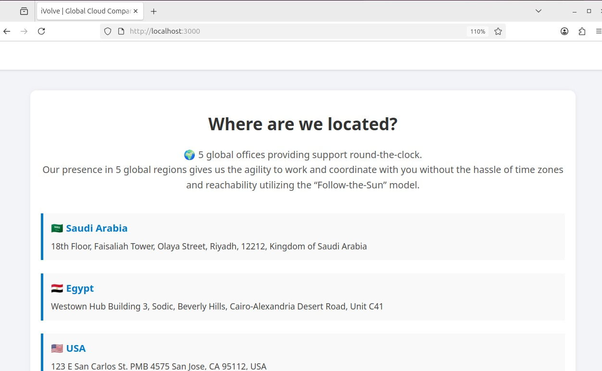
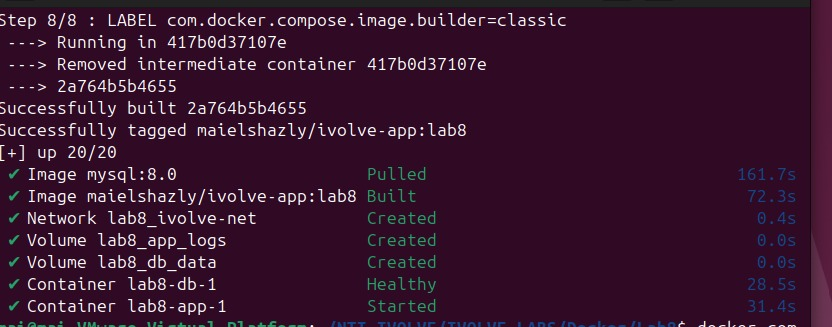
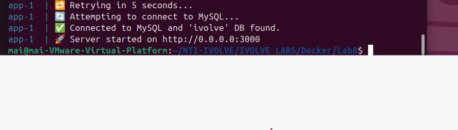
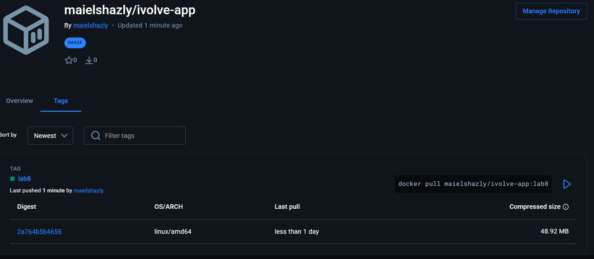

# 01 — Docker Compose: application and database

## Purpose

Lab 8 packages a Node.js web service and a MySQL database as separate containers, then runs them together with Docker Compose. Separating the services makes each component easier to replace, inspect, and configure.

## How a request reaches MySQL

1. Docker builds the `app` image from the root `Dockerfile`.
2. The app container starts `server.js` and listens on container port `3000`.
3. Compose publishes host port `3000` to app port `3000`, so a browser can open `http://localhost:3000`.
4. MySQL runs in its own `db` container. Both containers are attached to `ivolve-net`.
5. Compose's internal DNS resolves the service name `db`; therefore `DB_HOST=db` works inside the app container. `localhost` inside the app container would refer to the app container itself, not MySQL.
6. The app reads `DB_HOST`, `DB_USER`, `DB_PASSWORD`, and `DB_NAME` from its environment.
7. `depends_on` waits for the MySQL health check. The health check runs `mysqladmin ping` until the database server accepts connections.
8. `db_data` stores MySQL files and `app_logs` stores app logs. The data persists when containers are replaced.

## Run it

PowerShell from the project root:

```powershell
Copy-Item .env.example .env
notepad .env
# Replace both placeholder passwords, save, and close.
docker compose config
docker compose up -d --build
docker compose ps
docker compose logs -f app
```

Verify `http://localhost:3000`, then `http://localhost:3000/health`. The health route checks the app's database connection.

The application UI, Compose startup, successful MySQL connection, and published image are shown here:









Stop containers while retaining data:

```powershell
docker compose down
```

Delete containers and volumes (including database data) only when intentionally resetting:

```powershell
docker compose down -v
```

## Important distinctions

- An image is a template; a container is a running instance of that image.
- A Docker network provides service-to-service communication and service-name DNS.
- A volume keeps data outside a container's writable layer.
- `.env.example` is safe to commit because it contains placeholders. `.env` has real local credentials and is excluded by `.gitignore`.
- `docker compose push app` publishes the app image to a registry after authenticating. Never commit a Docker Hub password or token.
