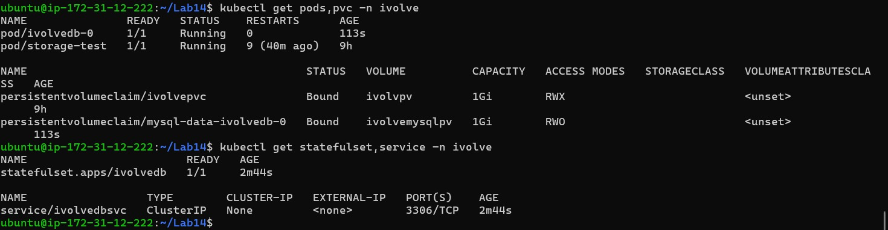
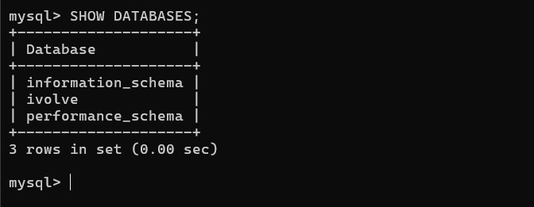
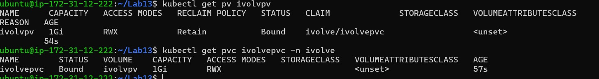
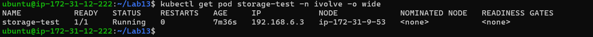
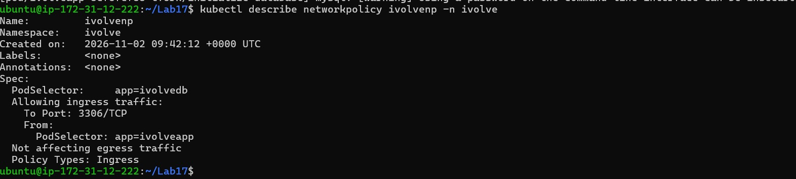
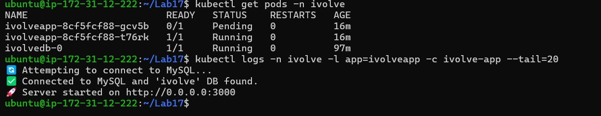

# Kubernetes resources

This repository keeps only the final application resources under `k8s/`, the directory watched by Argo CD:

- `deployment.yaml` — application Deployment, including database initialization, configuration, scheduling constraints, and log-volume mount.
- `service.yaml` — internal ClusterIP endpoint for application Pods.
- `network-policy.yaml` — allows the application Pods to connect to MySQL on TCP 3306.

The cluster's namespace, quota, ConfigMap, database Secret, persistent volumes, MySQL StatefulSet, and headless Service are prerequisites. Create and verify those resources in the cluster before deploying the application. They are intentionally not duplicated in this repository's GitOps path.

## Apply or inspect the application resources

Argo CD normally applies the resources from Git after detecting a commit. For a manual validation in a development cluster:

```bash
kubectl apply --dry-run=server -f k8s/deployment.yaml
kubectl apply --dry-run=server -f k8s/service.yaml
kubectl apply --dry-run=server -f k8s/network-policy.yaml
```

Inspect the current state:

```bash
kubectl get deployment,pods,service,networkpolicy -n ivolve
kubectl get pv,pvc -n ivolve
kubectl describe deployment ivolveapp -n ivolve
```

## Design notes

- **Labels and selectors** connect Deployments to Pods and Services to their backend Pods.
- **Node selector and toleration** allow scheduling on the designated application worker while respecting its taint.
- **Requests and limits** inform scheduling and cap container usage. Set requests to values that fit actual node capacity.
- **Service** provides a stable in-cluster name and virtual IP while Pods are replaced.
- **NetworkPolicy** restricts MySQL ingress to application Pods on TCP port 3306; enforcement requires a compatible network plugin such as Calico.
- **ConfigMap and Secret references** keep non-sensitive settings and passwords out of the application image. Supply real database credentials securely in the cluster; never commit populated Secrets.
- **Persistent storage** is provisioned separately. The application mounts the existing claim for logs; MySQL uses its own persistent claim.

The broader platform setup and operational procedures are described in `docs/02-kubeadm-cluster.md` and `docs/05-argocd-gitops.md`.

The prerequisite MySQL StatefulSet and persistent claims were verified before syncing the application. The database check confirms the `ivolve` schema is present:





The application log claim is also bound and mounted at `/app/logs`:





The NetworkPolicy selects MySQL and permits TCP `3306` only from application Pods:




